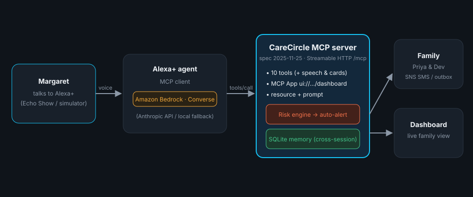

# CareCircle: Alexa+ that remembers, so families don't have to worry

CareCircle is a **self-hosted MCP server** (spec **2025-11-25**, **Streamable HTTP**) that gives Alexa+ a long-term
memory and the judgment to look after an older adult who lives alone. Margaret, 78, just talks to Alexa the way she
always has. CareCircle remembers her medicines, how she feels and when her pills run low, reminds her at the right
time, and **decides on its own** when her daughter and son need to know.

> Built for **Build, Ship, Shape: Amazon Developer Hackathon**: **Alexa+ track** (self-hosted MCP server and a
> simulated Alexa+ experience), plus the **AWS Builder** and **Open Source** mini challenges.

[](https://render.com/deploy?repo=https://github.com/hasini0/carecircle)



## Why

About 1 in 4 adults over 65 lives alone, and missed medication is one of the most common reasons older adults end
up in hospital. Families either call every day to ask "did you take your pills?" or find out too late. A voice
assistant is already in the kitchen. It needs memory, timing and judgment.

## What it does

| Moment | MCP tool | What happens |
|---|---|---|
| 8:00 PM, nobody said anything | `check_nudges` | **Alexa+ speaks first:** "Margaret, it's time for your Metformin." Each dose is reminded once |
| "I just took my Metformin" | `log_medication` | Logged against the right dose; supply drops to 5 days, so **Priya is asked to pick up a refill** |
| "I'm a bit dizzy and only slept 4 hours" | `daily_checkin` | Risk engine flags a red-flag phrase and **alerts Priya & Dev at high urgency**; her phone turns red |
| Priya types "Call you at 7?" in the app | `get_family_messages` | The device announces a new message, Alexa+ reads it out, and Priya gets a "heard ✓" receipt |
| "Get me ready for Dr. Chen" | `prepare_doctor_visit` | Visit brief: adherence, missed doses per medicine, mood and sleep, symptoms in her own words |
| "Show me the dashboard" | `show_care_dashboard` | An **MCP App**: the host reads `ui://carecircle/dashboard.html` over MCP and renders it |
| "How's Mom been this week?" | `get_wellbeing_summary` | Adherence %, mood trend and alerts as a spoken summary plus a card |
| "Let Priya know I'd love a call" | `alert_family` | Messages just Priya |

### The judgment (risk engine, `server/store.py`)

After every dose and check-in, CareCircle decides by itself whether to escalate:

| Signal | Urgency | Who hears |
|---|---|---|
| Red-flag phrase: fall, dizziness, chest pain, confusion, short of breath | high | everyone |
| 2+ missed or skipped doses today | medium | everyone |
| Low mood two check-ins in a row | medium | everyone |
| Under 5 h sleep two nights running | low | one person |
| A medicine with 5 days of supply or less | low | one person |

The same trigger is de-duplicated for 6 hours so families aren't spammed. Everything persists in SQLite, so the
memory survives sessions, devices and restarts.

## MCP surface

- **15 tools:** `whats_next`, `log_medication`, `daily_checkin`, `check_nudges`, `get_family_messages`,
  `get_refill_status`, `record_refill`, `prepare_doctor_visit`, `get_wellbeing_summary`, `alert_family`,
  `show_care_dashboard`, `get_medication_schedule`, `add_medication`, `add_appointment`, `setup_person`
- **MCP Apps extension** (`io.modelcontextprotocol/ui`): `show_care_dashboard` → `ui://carecircle/dashboard.html`
  (`text/html;profile=mcp-app`). The simulator is a minimal MCP Apps host: it reads the resource and posts the
  tool result into a sandboxed iframe (`ui/notifications/tool-result`).
- **Resource template:** `carecircle://people/{name}/profile`
- **Prompt:** `morning_routine`
- Every tool returns `speech` (what Alexa says), `card` (what a screen shows) and structured data.
- DNS-rebinding protection stays on in production: only localhost and the deployed hostname are accepted.

## Run it locally (2 minutes)

Requires Python 3.10+.

```bash
./run.sh
```

Then open **http://localhost:8000**. The live demo page shows three things side by side:

- **Margaret's kitchen:** an Echo Show–style Alexa+ simulator with a mic (Chrome), spoken replies, cards and proactive reminders
- **Priya's phone:** the CareCircle family app, updating live (also at `/family`)
- **Under the hood:** every MCP request, live, with arguments, latency and results

The **demo clock** buttons (8 AM / 1 PM / 8 PM) shift CareCircle's clock so reminders fire on cue. **Reset demo**
restores a fresh week of history.

MCP endpoint: `http://localhost:8000/mcp`

```bash
npx @modelcontextprotocol/inspector     # connect to http://localhost:8000/mcp (Streamable HTTP)
```

```python
from mcp import Client
async with Client("http://localhost:8000/mcp") as c:
    r = await c.call_tool("whats_next", {"person": "Margaret"})
    print(r.structured_content["speech"])
```

## Deploy

**Render (free, ~3 minutes):** click the **Deploy to Render** button above, sign in with GitHub, and press **Apply**.
`render.yaml` configures everything. You get `https://carecircle-xxxx.onrender.com`, with the MCP endpoint at `/mcp`.
On the free plan the service sleeps after 15 minutes idle, and the first request takes about 30 s to wake it.

**Docker (anywhere):**

```bash
docker build -t carecircle . && docker run -p 8000:8000 -e PUBLIC_HOSTS=your.domain.com carecircle
```

`PUBLIC_HOSTS` (comma-separated) is the list of hostnames the MCP endpoint accepts besides localhost. Render's
hostname is picked up automatically.

## The Alexa+ agent's brain (Amazon Bedrock)

`simulator/agent.py` connects to CareCircle **as a real MCP client** and picks its model automatically:

1. **Amazon Bedrock** (Converse API with tool use): when AWS credentials are present.
   Model: `CARECIRCLE_BEDROCK_MODEL` (default `us.anthropic.claude-haiku-4-5-20251001-v1:0`).
2. **Anthropic API:** if `ANTHROPIC_API_KEY` is set.
3. **Local planner:** deterministic intent routing, so the demo runs with **no keys**.

Whichever brain runs, every action is an MCP `tools/call`. Force one with `CARECIRCLE_BRAIN=bedrock|anthropic|local`.
Optional SMS/email to family through **Amazon SNS**: set `CARECIRCLE_SNS_TOPIC_ARN`. Without it, alerts go to `data/outbox.jsonl`.

## Project layout

```
server/carecircle_server.py   MCP server: 15 tools, MCP App, resource, prompt, website + APIs (one process)
server/store.py               SQLite memory, risk engine, reminders, refills, messages, doctor brief
server/notify.py              family alert delivery (outbox / Amazon SNS)
server/ui/dashboard.html      family app, also served as the MCP App resource
simulator/agent.py            Alexa+ agent: MCP client + Bedrock / Anthropic / local brain
web/index.html                live demo: Echo Show simulator, family phone, MCP inspector
scripts/seed_demo.py          demo persona + a week of history
render.yaml, Dockerfile       deployment
```

## Limits (honest)

- CareCircle is a reminder and family-communication tool, **not a medical device**. It doesn't diagnose, and a
  red-flag alert tells family; it doesn't call emergency services.
- The Alexa+ device is simulated (the hackathon's official simulation path). The MCP server is real and works with
  any MCP 2025-11-25 client.
- The demo is a single household with no sign-in, and the public demo is shared by everyone who opens it. Next
  step: OAuth 2.1 per household (supported by the MCP SDK).

## License

MIT, see [LICENSE](LICENSE).
